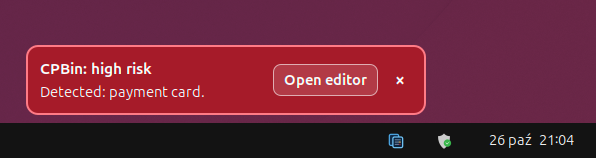
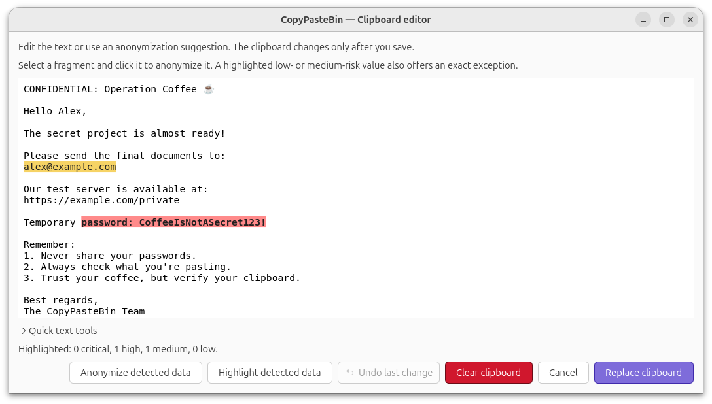
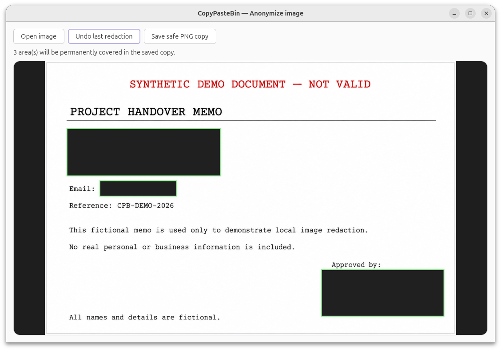
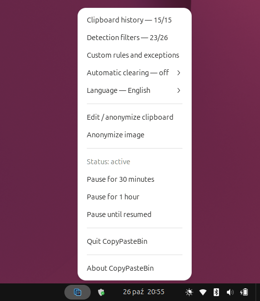
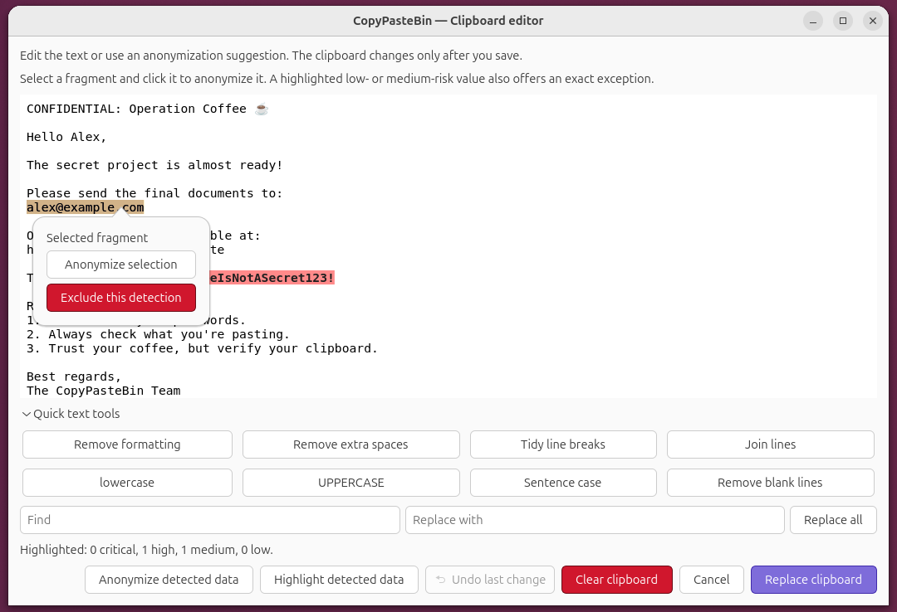
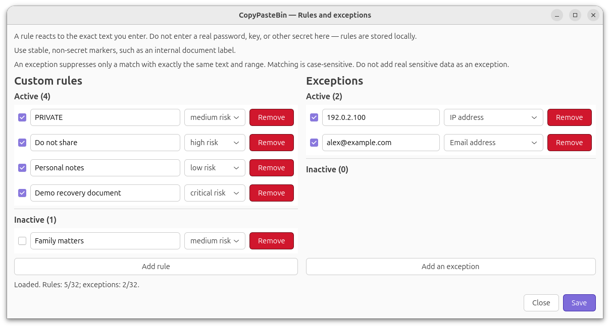
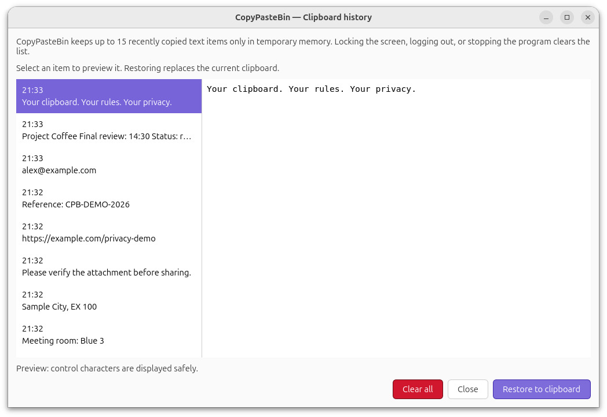

#  CopyPasteBin

**English** | [Polski](README.pl.md)

**[Open the CopyPasteBin website](https://kozlowska-anna.github.io/CopyPasteBin/en/)**

[Download version 1.1](#install-version-11) · [Documentation](#documentation) · [Security model](SECURITY.md)

## More control before you paste

CopyPasteBin helps you notice sensitive information in copied text before it
reaches a chat, email, document, or terminal. Analysis runs locally, and the
decision always stays with you.

### Why use it

- **Notice risk earlier.** A warning appears when text resembles a supported
  kind of sensitive information.
- **Keep the decision.** CopyPasteBin helps you review text, but it does not
  paste it or change the clipboard automatically by default.
- **Keep data on your device.** Detection and redaction run without sending
  clipboard contents to cloud services.
- **Prepare safer text.** Safe Paste and the editor help remove or redact
  selected values before you share them.

### In everyday work

Copy as usual. CopyPasteBin works in the background and gives you a moment to
review text before using it in a conversation, message, document, or command.

### You stay in control

CopyPasteBin warns and suggests edits, but saving a replacement requires an
explicit action. Optional clearing of an unchanged warning-triggering clipboard
entry works only after you enable it.

### Honest protection boundaries

No warning means only that no known, enabled pattern matched. CopyPasteBin
helps reduce risk, but it cannot guarantee detection of all sensitive
information and does not block pasting.

## Features

- **Sensitive-data detection:** supported patterns include API keys, access
  tokens, recovery keys, payment information, personal identifiers, network
  addresses, private paths, database connection strings, and more.
- **Four risk levels:** low, medium, high, and critical.
- **Review and redaction:** inspect detected content and explicitly replace the
  clipboard only after reviewing the result.
- **Image redaction:** open a local PNG or JPEG on demand, cover selected areas,
  and save a new PNG without modifying the original file.
- **Safe Paste:** press `Super+Shift+V` to inspect clipboard text without
  automatically pasting it into the active application.
- **Exact exclusions:** suppress a known low- or medium-risk match without
  disabling its entire category. High- and critical-risk matches cannot be
  permanently excluded.
- **Local history model:** persistent history contains limited metadata and an
  HMAC, not clipboard text. Up to 15 recent text entries can be retained in
  session memory.
- **Configurable protection:** enable or disable detection categories, add
  literal custom rules, pause monitoring, or opt in to clearing an unchanged
  warning-triggering clipboard entry after 1, 5, or 15 minutes.
- **English and Polish interface.**

CopyPasteBin does not take over `Ctrl+V`, globally intercept keyboard input, or
paste text on your behalf.

## CopyPasteBin screenshots

### Sensitive Data Warning

When an enabled pattern matches, CopyPasteBin displays a risk-colored banner
with safe category names and counts, never the clipboard text itself. The
single action opens the editor for review.



### Clipboard Editor & Risk Highlighting

The editor highlights ranges found by the same local detector and prepares a
redaction suggestion. The clipboard changes only after **Replace clipboard**;
canceling leaves it unchanged. The screenshot uses synthetic demonstration
text.



### Local Image Redaction

The local image editor lets the user manually cover selected areas and save a
new PNG copy without modifying the original image.



<details>
<summary><strong>More CopyPasteBin screenshots</strong></summary>

### GNOME Desktop Integration

The panel menu shows whether monitoring is active and opens the session-only
recent clipboard, detection filters, custom rules and exact exclusions,
automatic clearing, language settings, the clipboard editor, pause controls,
and the local About window.



### Selective Anonymization

Clicking a highlighted low- or medium-risk match selects its exact range. You
can anonymize only that selection or, after confirmation, add an exact,
case-sensitive exclusion for that value and category. High- and critical-risk
matches can be anonymized but cannot be excluded.



### Custom Rules & Exceptions

Custom rules are bounded, local, exact, case-sensitive literals with an
assigned risk level. Each rule can be enabled or disabled. Exact exclusions
are available only for supported low- and medium-risk detections; real
passwords, keys, and other secrets should never be saved as rules or
exclusions.



### Recent clipboard in session memory

The separate window shows up to 15 recently copied text entries held only in
process memory. Locking the screen, logging out, or stopping the extension
clears the list. Restoring an entry requires an explicit action. This list is
separate from the persistent history, which stores limited metadata and an
HMAC but no clipboard text.



</details>

## Compatibility

Version 1.1 supports the following environment:

| Component | Requirement |
| --- | --- |
| Operating system | Linux |
| Desktop | GNOME Shell 50 |
| Display server | Wayland |
| Python | 3.11 or newer, with `venv` |
| Additional components | GJS, GTK 4, GioUnix, GNOME Extensions, `sha256sum` |

Cinnamon, KDE Plasma, and Xfce desktop integrations are not supported in
version 1.1. The installer stops safely when GNOME Shell is unavailable.

## Install version 1.1

Choose one installation method:

- [⬇ Download the Debian package](https://github.com/kozlowska-anna/CopyPasteBin/releases/download/v1.1/copypastebin_1.1-1_all.deb) for a system installation managed by APT.
- [⬇ Download the tar.gz archive](https://github.com/kozlowska-anna/CopyPasteBin/releases/download/v1.1/CopyPasteBin-linux-1.1.tar.gz) for a user-local installation without `sudo`.
- [Download `SHA256SUMS`](https://github.com/kozlowska-anna/CopyPasteBin/releases/download/v1.1/SHA256SUMS) and verify the selected file before opening it:

```sh
sha256sum --check --ignore-missing SHA256SUMS
```

**Do not install both variants at the same time.** Follow the
[complete English installation guide](docs/offline-installation.en.md) for
verification, installation, update, switching methods, and removal.

For the user-local archive, run the read-only compatibility check after
extracting it:

```sh
./install.sh --check-only
```

If the compatibility check succeeds, install CopyPasteBin for the current
user:

```sh
./install.sh
```

Installation does not require `sudo`, a package manager, or network access.
Log out and log back in to activate the GNOME Shell extension. CopyPasteBin
should then start automatically.

To update the archive installation, run `./install.sh` from the new package.
To update a local DEB, use APT with the new file. Updates and removal preserve
the user's private configuration and history.

### Learning about new versions

CopyPasteBin does not check for updates in the background. New versions are
published on the [releases page](https://github.com/kozlowska-anna/CopyPasteBin/releases).
To receive GitHub notifications, choose **Watch → Custom → Releases** in the
repository.

## Privacy and security

CopyPasteBin is designed to minimize unnecessary access and storage:

- clipboard inspection and pattern matching run locally;
- clipboard text is not uploaded by CopyPasteBin;
- persistent history stores metadata and an HMAC, not original or redacted
  clipboard text;
- recent clipboard entries exist only in process memory and are cleared when
  the extension is disabled, the screen is locked, or the session ends;
- text passed between components uses bounded standard input and output, not
  command-line arguments, environment variables, logs, or temporary files;
- normal detection does not modify the clipboard;
- clipboard replacement requires an explicit action in the editor, except for
  optional automatic clearing that the user must enable first.

CopyPasteBin does not protect against an administrator, another process running
as the same user, a clipboard manager, screen observation, or a compromised
source or destination application. Runtime memory is not guaranteed to be
cryptographically erased and may be affected by swap or hibernation.

Read the [security model](SECURITY.md) and the
[version 1 contract (Polish)](docs/v1-contract.md) before relying on
CopyPasteBin in a sensitive workflow.

## Documentation

- [Technical overview (Polish)](docs/technical-overview.pl.md)
- [Roadmap](ROADMAP.md)
- [Offline installation (English)](docs/offline-installation.en.md)
- [Instalacja offline (polski)](docs/offline-installation.md)
- [Image redaction](docs/image-redaction.md)
- [Anonimizacja obrazów (polski)](docs/image-redaction.pl.md)
- [Security model (English)](SECURITY.md)
- [Model bezpieczeństwa (Polish)](docs/security.pl.md)
- [Architecture (Polish)](docs/architecture.md)
- [GNOME event backend (Polish)](docs/gnome-event-backend.md)
- [Third-party data (Polish)](docs/third-party-data.md)
- [Changelog (Polish)](CHANGELOG.md)

## Development and verification

The automated suite uses synthetic fixtures and temporary directories. It does
not require real clipboard contents or private user data.

```sh
PYTHONPATH=src python3 -m unittest discover -s tests -v
PYTHONPATH=src python3 benchmarks/detection_quality.py
```

The synthetic detection benchmark passed 26/26. Automated checks do not
replace a test in a running GNOME Shell session.

## License and authorship

Copyright © 2026 Anna Kozłowska.

CopyPasteBin is licensed under
[GNU GPL-3.0-or-later](LICENSE). Third-party notices are provided in
[NOTICE](NOTICE).

Development was assisted by ChatGPT and Codex from OpenAI. CopyPasteBin is an
independent project and is not affiliated with, endorsed by, or sponsored by
OpenAI.
