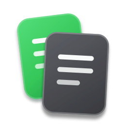
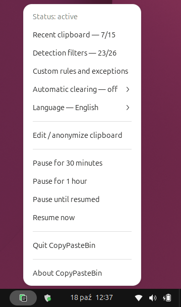
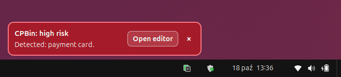
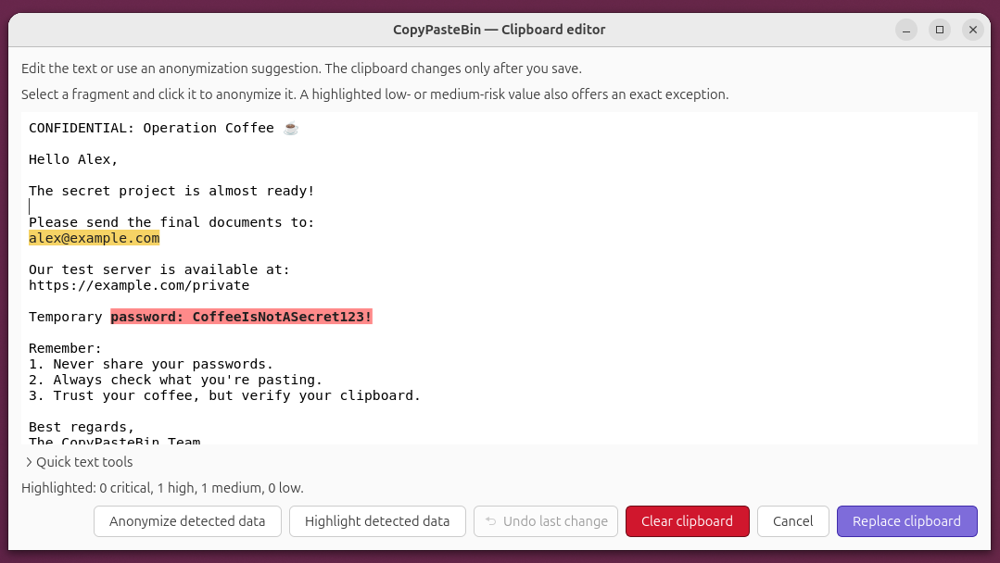
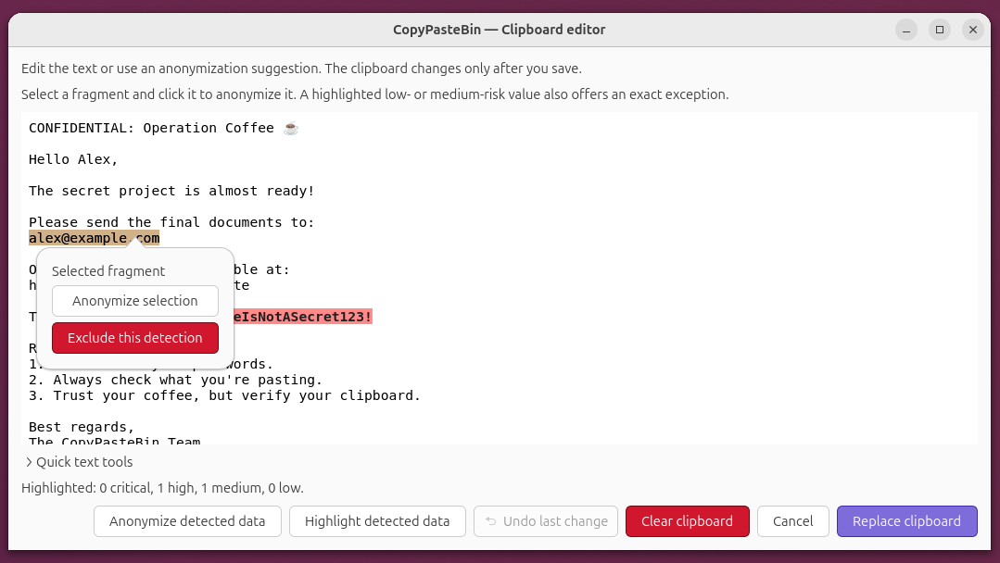
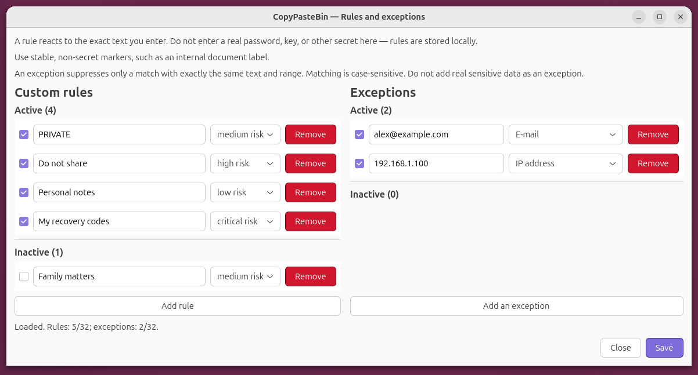
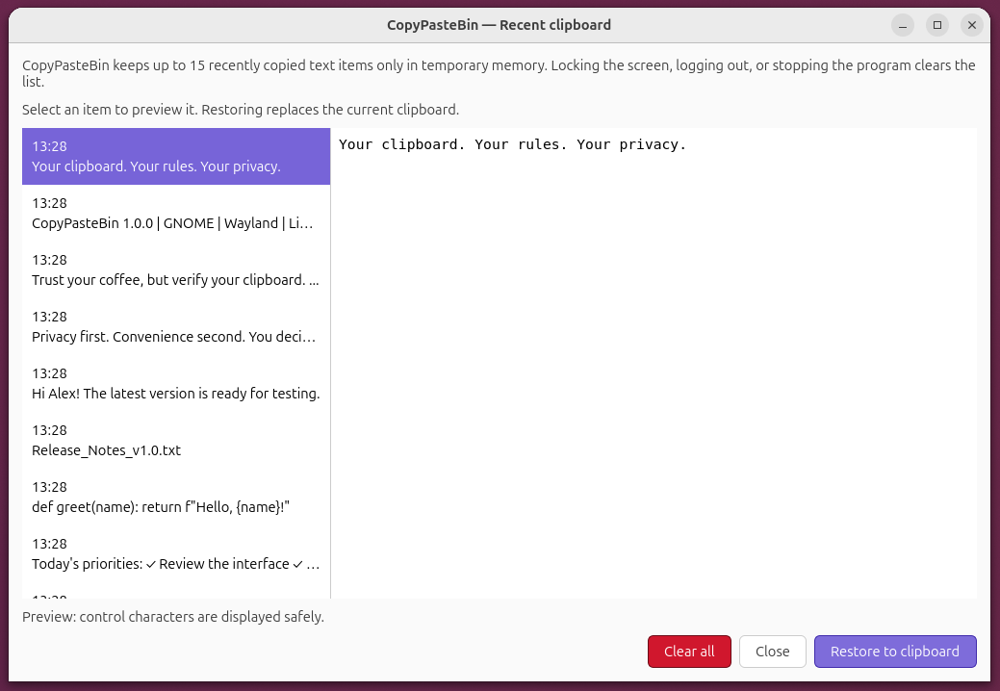

<h1>
  
  <br /><br /><br />
  CopyPasteBin
</h1>

[English](README.md) | **Polski**

[Pobieranie / Instalacja](#instalacja-wersji-100)

## Więcej kontroli zanim wkleisz

CopyPasteBin pomaga zauważyć dane wrażliwe w skopiowanym tekście, zanim trafią
do czatu, maila, dokumentu lub terminala. Analiza działa lokalnie, a decyzja
zawsze należy do Ciebie.

### Dlaczego warto

- **Zauważasz ryzyko wcześniej.** Ostrzeżenie pojawia się, gdy tekst przypomina
  obsługiwany rodzaj danych wrażliwych.
- **Decyzja należy do Ciebie.** Program pomaga ocenić tekst, ale nie wkleja go
  i domyślnie nie zmienia schowka automatycznie.
- **Twoje dane zostają na komputerze.** Wykrywanie i anonimizacja działają bez
  wysyłania treści do chmury.
- **Łatwiej poprawiasz tekst.** Bezpieczne wklejenie i edytor pomagają usunąć
  albo zanonimizować wybrane wartości przed użyciem.

### W codziennej pracy

Kopiujesz jak zwykle. CopyPasteBin pracuje w tle i daje Ci chwilę na
sprawdzenie tekstu przed użyciem go w rozmowie, wiadomości, dokumencie lub
poleceniu.

### Ty zachowujesz kontrolę

CopyPasteBin ostrzega i proponuje poprawki, lecz zapis wymaga jawnej akcji.
Opcjonalne czyszczenie niezmienionego ostrzegającego schowka działa tylko po
świadomym włączeniu przez użytkownika.

### Uczciwie o ochronie

Brak ostrzeżenia oznacza tylko, że program nie wykrył znanego, aktywnego
wzorca. CopyPasteBin pomaga ograniczać ryzyko, ale nie gwarantuje wykrycia
wszystkich danych wrażliwych i nie blokuje wklejania.

## Najważniejsze funkcje

- **Wykrywanie danych wrażliwych:** obsługiwane wzorce obejmują między innymi
  klucze API, tokeny dostępu, klucze odzyskiwania, dane płatnicze,
  identyfikatory osobowe, adresy sieciowe, prywatne ścieżki i ciągi połączeń
  baz danych.
- **Cztery poziomy ryzyka:** niski, średni, wysoki i krytyczny.
- **Sprawdzanie i anonimizacja:** możesz obejrzeć wykryte dane i jawnie
  zastąpić schowek dopiero po sprawdzeniu wyniku.
- **Bezpieczne wklejenie:** skrót `Super+Shift+V` sprawdza tekst bez
  automatycznego wklejania go do aktywnej aplikacji.
- **Dokładne wykluczenia:** znane trafienie niskiego lub średniego ryzyka można
  wyciszyć bez wyłączania całej kategorii. Trafień wysokiego i krytycznego
  ryzyka nie można trwale wykluczać.
- **Lokalny model historii:** trwała historia zawiera ograniczone metadane i
  HMAC, a nie treść schowka. Do 15 ostatnich tekstów może być przechowywanych
  w pamięci bieżącej sesji.
- **Konfigurowalna ochrona:** można zmieniać kategorie detekcji, dodawać własne
  reguły dosłowne, wstrzymać monitorowanie albo świadomie włączyć czyszczenie
  niezmienionego ostrzegającego schowka po 1, 5 lub 15 minutach.
- **Polski i angielski interfejs.**

CopyPasteBin nie przejmuje `Ctrl+V`, nie podsłuchuje globalnie klawiatury i
nie wkleja tekstu w imieniu użytkownika.

## CopyPasteBin na ekranie

### Integracja z pulpitem GNOME

Menu pokazuje stan monitorowania i daje dostęp do sesyjnej listy ostatnich
tekstów, filtrów, reguł i wykluczeń, automatycznego czyszczenia, ustawień
języka, edytora, pauzy oraz lokalnego okna „O programie”.



### Ostrzeżenie o danych wrażliwych

Po wykryciu aktywnego wzorca CopyPasteBin pokazuje banner w kolorze poziomu
ryzyka. Widoczne są wyłącznie bezpieczne nazwy kategorii i liczba trafień,
nigdy treść schowka. Przycisk otwiera edytor.



### Edytor schowka

Edytor podświetla fragmenty znalezione przez lokalny detektor i przygotowuje
propozycję anonimizacji. Schowek zmienia się dopiero po kliknięciu „Zastąp
schowek”; anulowanie nie wprowadza zmian. Zrzut używa syntetycznych danych.



### Anonimizacja wybranego fragmentu

Kliknięcie trafienia niskiego lub średniego ryzyka wybiera jego dokładny
zakres. Można zanonimizować tylko ten fragment albo po potwierdzeniu dodać
dokładne, rozróżniające wielkość liter wykluczenie. Trafienia wysokiego i
krytycznego ryzyka można anonimizować, ale nie można ich wykluczać.



### Reguły własne i wykluczenia

Reguły własne są lokalnymi, ograniczonymi i dokładnymi literałami z przypisanym
poziomem ryzyka. Każdą regułę można włączać i wyłączać. Dokładne wykluczenia
działają tylko dla obsługiwanych trafień niskiego i średniego ryzyka.
Prawdziwych haseł, kluczy ani innych sekretów nie należy zapisywać jako reguł
lub wykluczeń.



### Ostatnie wpisy tylko w pamięci sesji

Osobne okno pokazuje do 15 ostatnio skopiowanych tekstów przechowywanych
wyłącznie w pamięci procesu. Lista znika po zablokowaniu ekranu, wylogowaniu
lub zatrzymaniu rozszerzenia, a przywrócenie wpisu wymaga jawnej akcji. Jest
oddzielona od trwałej historii, która zapisuje ograniczone metadane i HMAC,
lecz nie treść schowka.



## Zgodność

Wersja 1.0.0 obsługuje następujące środowisko:

| Element | Wymaganie |
| --- | --- |
| System operacyjny | Linux |
| Pulpit | GNOME Shell 50 |
| Serwer wyświetlania | Wayland |
| Python | 3.11 lub nowszy, z modułem `venv` |
| Dodatkowe komponenty | GJS, GTK 4, GioUnix, GNOME Extensions, `sha256sum` |

Integracje z pulpitami Cinnamon, KDE Plasma i Xfce nie są obsługiwane w wersji
1.0.0. Instalator bezpiecznie zatrzymuje się, jeśli GNOME Shell nie jest
dostępny.

## Instalacja wersji 1.0.0

### [⬇ Pobierz CopyPasteBin 1.0.0 dla Linuksa (.tar.gz)](https://github.com/kozlowska-anna/CopyPasteBin/releases/download/v1.0.0/CopyPasteBin-offline-linux-1.0.0.tar.gz)

Pobierz również [sumę kontrolną SHA-256](https://github.com/kozlowska-anna/CopyPasteBin/releases/download/v1.0.0/CopyPasteBin-offline-linux-1.0.0.tar.gz.sha256),
a następnie skorzystaj z [polskiej instrukcji instalacji](docs/offline-installation.md),
aby sprawdzić plik przed jego otwarciem.

Uruchom kontrolę zgodności, która niczego nie zmienia:

```sh
./install.sh --check-only
```

Jeżeli kontrola zgłosi `Kontrola zgodności: OK`, zainstaluj CopyPasteBin dla
bieżącego użytkownika:

```sh
./install.sh
```

Instalacja nie wymaga `sudo`, menedżera pakietów ani połączenia z siecią.
Aby aktywować rozszerzenie GNOME Shell, wyloguj się i zaloguj ponownie.
CopyPasteBin powinien uruchomić się automatycznie.

Jeżeli program nie pojawi się po pierwszym logowaniu, przed ręcznym
uruchomieniem wykonaj dołączoną diagnostykę, która niczego nie zmienia:

```sh
./diagnose-first-activation.sh
```

Aby zaktualizować program, uruchom `./install.sh` z nowej paczki. Aby usunąć
zainstalowany kod, uruchom `./uninstall.sh`. Aktualizacja i usuwanie zachowują
prywatną konfigurację oraz historię użytkownika.

Pełne wymagania, pobieranie, weryfikację, aktualizację, usuwanie i rozwiązywanie
problemów opisuje [kompletna polska instrukcja instalacji](docs/offline-installation.md).

## Prywatność i bezpieczeństwo

CopyPasteBin ogranicza zbędny dostęp oraz ilość przechowywanych danych:

- sprawdzanie schowka i dopasowywanie wzorców odbywa się lokalnie;
- CopyPasteBin nie wysyła treści schowka;
- trwała historia zapisuje metadane i HMAC, ale nie oryginalny ani
  zanonimizowany tekst;
- ostatnie wpisy schowka istnieją tylko w pamięci procesu i są usuwane po
  wyłączeniu rozszerzenia, zablokowaniu ekranu lub zakończeniu sesji;
- tekst między komponentami przechodzi przez ograniczone standardowe wejście i
  wyjście, a nie argumenty poleceń, zmienne środowiskowe, logi lub pliki
  tymczasowe;
- zwykłe wykrywanie nie zmienia schowka;
- zastąpienie schowka wymaga jawnej akcji w edytorze, z wyjątkiem opcjonalnego
  automatycznego czyszczenia, które użytkownik musi najpierw włączyć.

CopyPasteBin nie chroni przed administratorem, innym procesem działającym jako
ten sam użytkownik, menedżerem schowka, obserwacją ekranu ani przejętą aplikacją
źródłową lub docelową. Nie ma gwarancji kryptograficznego wyzerowania pamięci,
na którą mogą także wpływać swap i hibernacja.

Przed użyciem CopyPasteBin w szczególnie wrażliwym procesie przeczytaj
[polski model bezpieczeństwa](docs/security.pl.md) oraz
[kontrakt wersji 1](docs/v1-contract.md).

## Dokumentacja

- [Szczegółowy opis techniczny](docs/technical-overview.pl.md)
- [Instalacja offline — polski](docs/offline-installation.md)
- [Offline installation — English](docs/offline-installation.en.md)
- [Model bezpieczeństwa — polski](docs/security.pl.md)
- [Security model — English](SECURITY.md)
- [Architektura](docs/architecture.md)
- [Backend zdarzeniowy GNOME](docs/gnome-event-backend.md)
- [Dane stron trzecich](docs/third-party-data.md)
- [Historia zmian](CHANGELOG.md)

## Rozwój i weryfikacja

Testy automatyczne korzystają z danych syntetycznych i katalogów tymczasowych.
Nie wymagają prawdziwej treści schowka ani prywatnych danych użytkownika.

```sh
PYTHONPATH=src python3 -m unittest discover -s tests -v
PYTHONPATH=src python3 benchmarks/detection_quality.py
```

Opublikowany snapshot wersji 1.0.0 przeszedł 307 testów automatycznych oraz
26-przypadkowy benchmark detekcji. Kontrole automatyczne nie zastępują testu
w działającej sesji GNOME Shell.

## Licencja i autorstwo

Copyright © 2026 Anna Kozłowska.

CopyPasteBin jest udostępniany na licencji
[GNU GPL-3.0-or-later](LICENSE). Informacje i warunki dotyczące danych stron
trzecich znajdują się w pliku [NOTICE](NOTICE).

Projekt powstaje przy wsparciu narzędzi ChatGPT i Codex od OpenAI.
CopyPasteBin jest niezależnym projektem; nie jest powiązany z OpenAI,
zatwierdzony przez OpenAI ani sponsorowany przez OpenAI.
